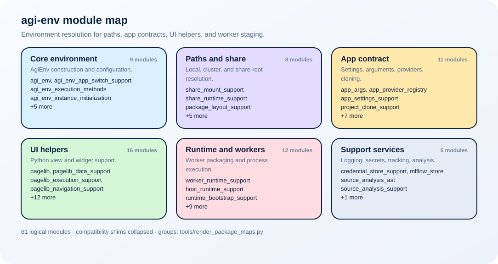
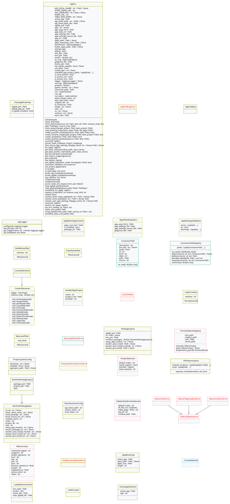

agi-env API
===========

``agi_env`` provides the shared headless environment and path-resolution layer
used by both AGILab and the core runtime packages. Native React UI/page dependencies
live in the separate ``agi-web`` package under ``src/agilab/lib/agi-web``.

.. note::

   This reference describes the current source checkout and the next
   published software development kit (SDK). PyPI release ``2026.11.2``
   does not include the local worker-root selector or the installed-SDK
   source-origin and default ``uv`` corrections described here.

Usage Example
-------------

Instanciation
^^^^^^^^^^^^^

.. literalinclude:: snippets/AgiEnv.instanciation.py
   :language: python

.. note::
   ``AgiEnv`` behaves as a singleton. Repeated instantiation updates the same
   environment instance. Call ``AgiEnv.reset()`` before configuring a new
   environment, or ``AgiEnv.current()`` to retrieve the active one.

Isolated resources for a run or notebook
^^^^^^^^^^^^^^^^^^^^^^^^^^^^^^^^^^^^^^^^

Set ``AGILAB_RESOURCES_DIR`` to a dedicated absolute directory before creating
``AgiEnv``. For example, select the context in the first notebook cell, before
importing the environment helpers:

.. code-block:: python

   import os

   os.environ["AGILAB_RESOURCES_DIR"] = "/absolute/path/qualification-resources"

The selected directory contains the environment's ``.env`` configuration and
resource files. Source-mode resource initialization applies to this directory.
The selector is resolved before configuration is loaded, and local child
processes inherit the selected context. Changing the process selector does not
redirect an already constructed environment's child processes.

The web interface uses the same resources context for its ``.env`` file. An
explicit ``--apps-path`` selects the application directory before installation
marker discovery, so this selection does not read the user installation marker.

Use a separate process for concurrent contexts. Configure run data through the
existing ``AGILAB_WORKFLOW_DATA_ROOT`` contract below. Select local worker
installation separately with ``AGILAB_WORKER_ROOT`` and provision workers
through the normal explicit deployment action. A resources directory
must also be valid on the host that uses it.

When the selector is unset, the existing default resource location and
configuration behavior apply. Provide a fully expanded path: an empty value,
a relative path and a literal ``~`` are invalid and fail before resource
initialization. See :doc:`environment` for the configuration reference.

Remote resource and resolver contexts
^^^^^^^^^^^^^^^^^^^^^^^^^^^^^^^^^^^^^

A remote worker selects its own resources before its dotenv transaction and
Python worker CLI start. Configure the existing per-host ``<worker-ip>_CMD_PREFIX``
in the manager's selected environment with a trusted POSIX command prefix:

.. code-block:: python

   from agi_env import AgiEnv

   AgiEnv.set_env_var(
       "192.0.2.10_CMD_PREFIX",
       "export AGILAB_RESOURCES_DIR='/srv/agilab/task-resources'; "
       "export UV_CACHE_DIR='/srv/agilab/task-cache';",
   )

Use the worker's address and absolute paths valid on that host. The SDK preserves
an explicit host prefix through deployment. The remote ``.env``, its stable lock,
and its fsynced temporary files use the selected resource directory. An invalid
selector fails before these writes. With no remote selector, the normal
``~/.agilab/.env`` location remains.

Manager-local resource and worker-root paths are not copied automatically to
another host. ``AGILAB_WORKER_ROOT`` continues to select the manager's local
installation root; ordinary remote staging retains the existing remote ``wenv``
layout.

For reviewed SDK artifacts, stage the selected wheels in a controlled remote
package index and select that index through the host prefix using uv's supported
``UV_INDEX`` configuration. The same prefix can select the remote cache.
``UV_OVERRIDE`` applies to uv's pip commands; it does not select wheel identities
for ``uv sync`` or ``uv add``. Verify the resolved wheel hashes and installed
dependency health before accepting a qualified run.

Isolated local worker installation
^^^^^^^^^^^^^^^^^^^^^^^^^^^^^^^^^^

Set ``AGILAB_WORKER_ROOT`` in the process environment before constructing
``AgiEnv`` to select a dedicated local installation directory:

.. code-block:: python

   import os

   os.environ["AGILAB_WORKER_ROOT"] = "/absolute/path/run-workers"
   from agi_env import AgiEnv

The worker environment and distribution artifacts use
``<selected-root>/<target>_worker`` and its ``dist`` directory. This selector
does not deploy workers: use the normal explicit deployment action or
``AGI.install`` before ``AGI.run``. With the selector unset, the existing
``home_abs/wenv`` layout remains, including managed-PC home handling.

Selection happens before dotenv loading. The expanded path must be absolute
and usable; blank values, parent traversal, symbolic links, filesystem roots,
the environment home and the current directory are rejected before
initialization writes. The environment freezes the selection for app
reinitialization and local child processes. A changed process selector cannot
redirect an existing environment's children; select a different context in a
new process or reset the environment first.

The selector concerns local installation only. Remote paths remain
``wenv/<worker>``, and manager-local installation paths are not added to SSH
settings. Run data still uses ``AGILAB_WORKFLOW_DATA_ROOT``. Cleanup remains
confined to the selected installation root and retains process ownership,
protected-directory and lifecycle-token checks.

For standalone notebook replay, configure the selector in the fresh kernel's
environment or a first cell before environment initialization. Verify the
kernel interpreter and the imported SDK before deployment. Notebook exports
do not embed a host-specific worker installation path as a portable plan;
each replay host must select its own valid local context.

Share directory resolution
^^^^^^^^^^^^^^^^^^^^^^^^^^^^^^

``AgiEnv`` exposes the resolved data root through
``AgiEnv.agi_share_path_abs``.
The path is derived from environment settings using the following precedence:

1. ``AGI_CLUSTER_SHARE`` from the persisted ``.env`` configuration, then the
   current process environment when the persisted value is unset or blank.
2. ``AGI_CLUSTER_SHARE`` fallback ``clustershare/<user>`` when no explicit
   cluster share is configured.
3. ``AGI_LOCAL_SHARE`` (default ``~/localshare/<user>``) when cluster mode is
   disabled.

The ``<user>`` segment is derived from ``AGILAB_SHARE_USER``, then ``USER``,
then ``USERNAME``, and is sanitised before being used as a path component.

This ordering lets operators set one shared-data knob in the UI/installer while
still allowing remote workers to honour host-specific cluster-share settings.
The behaviour differs depending on whether cluster mode is enabled:

* **Cluster mode enabled** – ``AgiEnv`` uses ``AGI_CLUSTER_SHARE``. Relative
  inputs are expanded against ``AgiEnv.home_abs`` on manager/developer shells.
  The configured share must be mounted and writable, and it must be distinct
  from ``AGI_LOCAL_SHARE``. The implicit fallback is ``clustershare/<user>``;
  if you override it in a multi-user deployment, keep the override per-user
  rather than pointing several operators at the same writable directory.
  The scheduler source must also be a dedicated directory; filesystem, home,
  and exact operating-system roots are rejected before remote fan-out.
  Missing or read-only shares now raise immediately instead of silently
  degrading to a local path.
* **Cluster mode disabled** – ``AgiEnv`` uses ``AGI_LOCAL_SHARE`` for local
  datasets and outputs.
* **Remote workers** – the configured cluster-share value remains relative
  (for example, ``clustershare/<user>``) and is not created automatically.
  Workers never fall back to per-user local paths; the configured share path
  must already be mounted and writable on the remote host. When an absolute
  path under ``/Users/<user>`` or ``/home/<user>`` is provided, the leading
  segments are stripped so the worker can re-root the remainder under its own
  home directory or mount point. An explicit worker mount target must name a
  dedicated directory such as ``/mnt/agilab``: filesystem roots, worker-home
  roots, and exact operating-system directories such as ``/mnt``, ``/var``,
  or ``/tmp`` are rejected before AGILAB creates a directory, mounts SSHFS, or
  updates the worker environment.

Because the worker value stays relative, it will fail fast if
``agi_share_path``
is not mounted. This makes data provenance explicit and avoids hidden copies of
datasets on remote machines.

Workflow/session data root
^^^^^^^^^^^^^^^^^^^^^^^^^^

``AGILAB_WORKFLOW_DATA_ROOT`` optionally narrows the active data namespace for
one workflow or cluster run without changing the physical
``AGI_CLUSTER_SHARE`` mount root. AGILAB normally manages this value for
workflow sessions and writes the corresponding worker-side value during remote
deployment; it is not intended as a second global share setting.

Relative values resolve under the runtime user's home directory. Output paths
are confined to this workflow root. Input paths prefer the workflow root and
may fall back to the same relative dataset path under the physical share root
when that pre-existing dataset is not copied into the workflow directory.
Absolute input and output values are still accepted only when the applicable
resolver confirms they remain inside one of those declared roots.

Per-user cluster-share isolation is part of that contract: each user should
resolve to their own share root so one operator's datasets and cluster-visible
outputs do not overwrite another operator's workspace. Generated snippets and
operator logs remain local under ``AGI_LOG_DIR``.

Reference
----------

.. automodule:: agi_env.agi_env
   :members:
   :show-inheritance:

