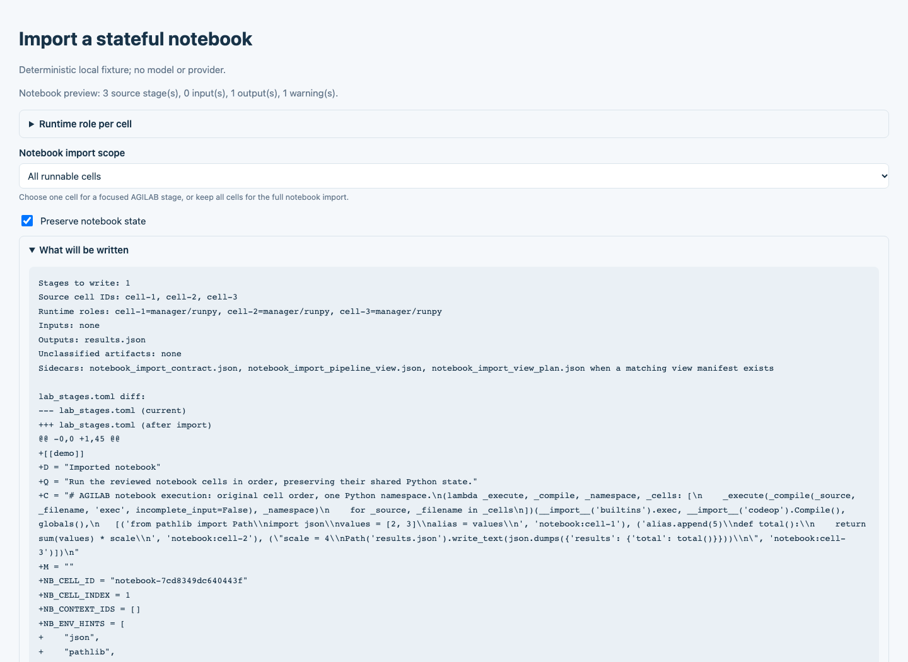
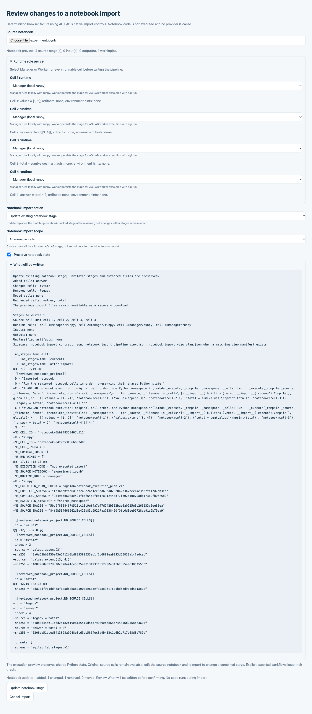
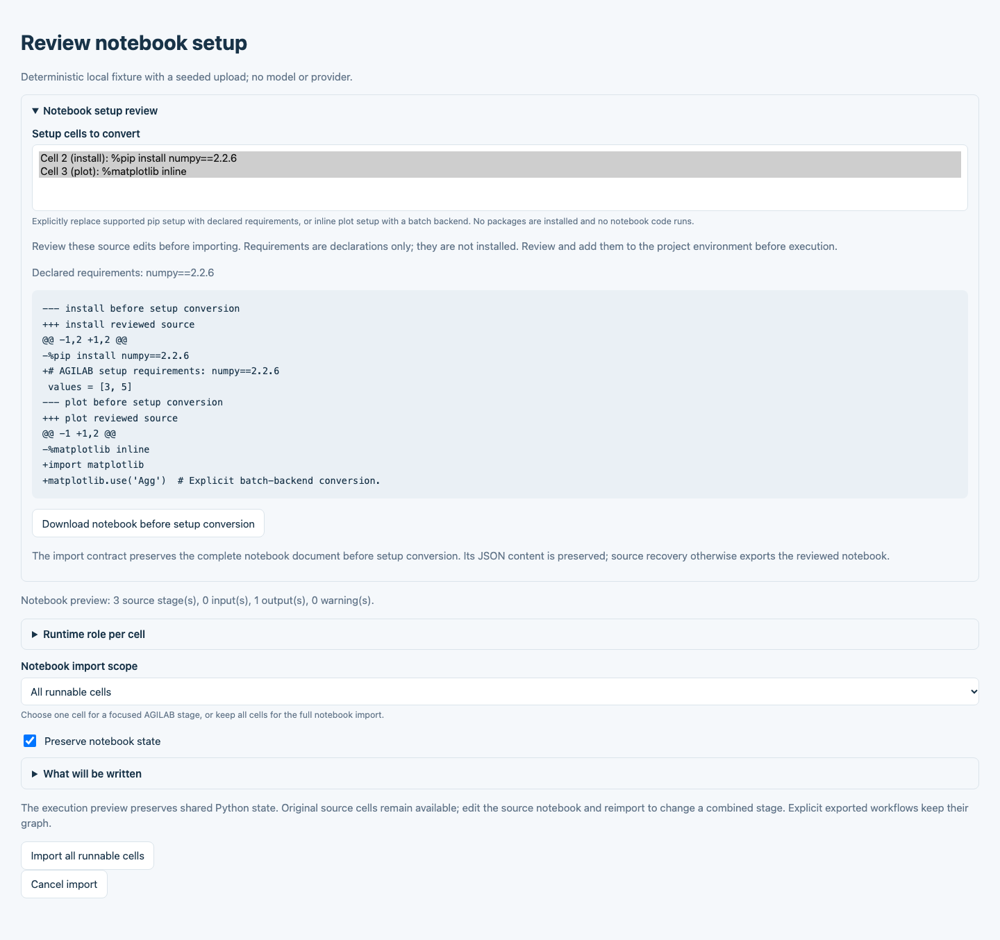
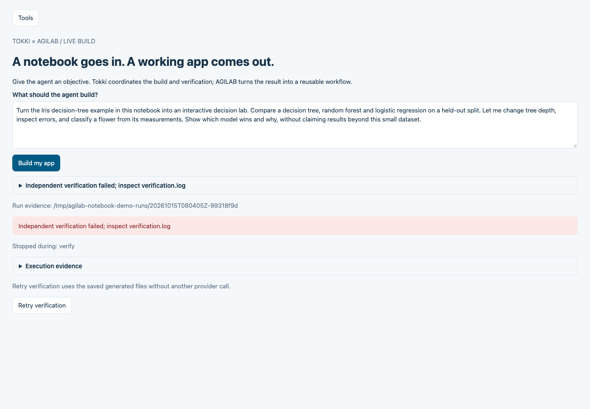

Advanced Notebook Routes
========================

This page keeps the broader notebook matrix for advanced users who explicitly
want source-checkout launchers, benchmark notebooks, Data + DAG examples, or
worker-path inspection.

If you want the smallest newcomer notebook path, use :doc:`notebook-quickstart`
instead.

Notebook evidence sandbox
-------------------------

Use the notebook sandbox when you want AGILAB to execute a local ``.ipynb`` file
and collect notebook evidence without first turning it into a full app:

.. code-block:: bash

   agilab run notebook \
     --notebook analysis.ipynb \
     --params params.json \
     --output run/notebook-sandbox \
     --json

Install the optional runner dependencies with ``agilab[notebook]``. In a source
checkout, use ``uv run --extra notebook agilab run notebook ...``.

The sandbox writes:

- ``prepared_notebook.ipynb`` with an injected ``AGILAB_PARAMS`` cell,
- ``executed_notebook.ipynb`` after kernel execution,
- redacted ``stdout.log`` and ``stderr.log``,
- an ``artifacts/`` directory for notebook-created files,
- ``notebook_sandbox_evidence.json``,
- ``run_manifest.json`` for the normal AGILAB evidence path.

The injected cell exposes ``AGILAB_PARAMS``, ``AGILAB_PARAMS_PATH``, and
``AGILAB_ARTIFACT_DIR``. Keys in ``params.json`` that are valid Python
identifiers are also added as globals for concise notebook cells.

This is a reproducibility sandbox, not hostile-code isolation. Run trusted
notebooks locally, or add an external container/VM boundary before using
untrusted notebooks.

Import, recovery and reviewed source edits
------------------------------------------

In **PROJECT**, choose **From notebook** when creating a project; in
**WORKFLOW**, open **Notebook** and upload the notebook. If setup cells block
import, review their explicit conversion first as described below. Review the
runtime roles, then select **Preserve notebook state** to compile the selected runnable
cells into one stage. Variables, aliases, mutations and function globals remain
in the same Python namespace when that stage runs, in original cell order.
The option is off by default, keeping the existing cell-by-cell editing mode
available.

State preservation requires one reviewed runtime and environment for the
selected cells. Incompatible choices block import before files are written or
a project is cloned; choose consistent runtimes or define explicit artifact
boundaries before splitting the work. A selected cell still needs its inputs;
the option does not restore omitted cells or a previous Jupyter kernel.
AGILAB supervisor exports keep their authored workflow graph in either mode.
For an ordinary notebook, reimporting cells already present in a shared stage
uses an explicit reviewed update, as described below. Adding overlapping cells
as another shared stage remains blocked so the workflow cannot silently retain
both copies; unrelated stages remain intact.

Import only prepares the workflow: it does not execute notebook code, install
packages or prove result correctness. Supply the required files and dependencies
before running it through the normal workflow controls. Compiled stages retain
the original cell sources and their hashes in ``lab_stages.toml``.

   State preservation selected in the native notebook import review.
   This deterministic local fixture demonstrates import controls, without a live
   provider call. Import itself does not run the notebook.

Update an imported notebook
~~~~~~~~~~~~~~~~~~~~~~~~~~~

After editing an ordinary source notebook, upload it again in **WORKFLOW**.
Select **Preserve notebook state**, then choose **Update existing notebook
stage** under **Notebook import action**. Review the added, changed and removed
source cells and the proposed stage before pressing **Update notebook stage**.
**Add notebook stages** remains the separate action for a new import.
**Cancel import** leaves the project files unchanged.

This update route applies to an ordinary notebook already imported as one shared
stage. Keep its stable, unique Jupyter code cell IDs. Missing or ambiguous source
identity and inconsistent runtime choices block replacement and require review.

The reviewed update replaces the matching notebook-backed stage. It retains
unrelated stages, including handwritten project stages, and repeating an update
does not append another copy of the notebook stage. Changes to the target after
review, or conflicting edits to the imported stage, block the update and require
a fresh review. AGILAB does not merge conflicting source edits automatically.
An authored AGILAB supervisor workflow retains its separate graph contract.

After a successful update, **Download previous notebook import** saves a recovery
bundle containing the exact earlier import files, their hashes and any recorded
absences. Keep that bundle before making further changes. It is a recovery
download; applying it is a separate manual operation. Updating an import does
not execute notebook cells, install packages or verify new results. Use the
normal workflow run and evidence verification after reviewing the source.

   Reviewing changes before replacing an existing notebook-backed stage.
   This deterministic local fixture uses the native import controls and a real
   upload, without a provider call or notebook execution.

Review setup cells
~~~~~~~~~~~~~~~~~~

For simple notebook setup, open **Notebook setup review** and choose the exact
**Setup cells to convert**. Nothing is selected by default. Review the source
diff and **Declared requirements** before confirming import or project creation.

Selected simple ``%pip`` or ``!pip install`` requirements become declarations;
``%matplotlib inline`` becomes an explicit non-interactive batch backend.
AGILAB reruns import preflight and runtime review on the converted source.
Unsupported installer options, URLs, requirement files, arbitrary shell commands
and other magics still require manual conversion. Unconverted blocking cells
continue to block import. Conversion does not install packages, run code or
establish that an execution environment is ready; prepare the required packages
and inputs before execution.

**Download notebook before setup conversion** recovers the preserved notebook
document, including its cells, metadata, outputs and attachments. This preserves
JSON content, not the upload's original whitespace or byte formatting. Successive
conversions retain the first preserved document; for an already-converted upload
it may predate that upload. Ordinary source export returns the reviewed notebook.
The existing import contract stores both the reviewed document and the
hash-verified earlier document, without replacing the source upload.

   Explicit setup selection and source review in the native notebook import.
   This deterministic local fixture demonstrates conversion controls without a
   provider call, package installation or notebook execution.

Source recovery
~~~~~~~~~~~~~~~

The WORKFLOW notebook upload path preserves a complete, hash-verified source
document in ``notebook_import_contract.json``. The original source remains
recoverable without executing it. Cell IDs, ordering, raw and empty cells,
attachments, outputs, custom metadata and the original kernel metadata survive
a source recovery.

Use the WORKFLOW downloads, or::

   python -m agilab.notebooks.notebook_pipeline_import source-export \
     --contract notebook_import_contract.json \
     --output agilab_authored_notebook_recovered.ipynb

For reviewed source edits, add
``--cell-edits agilab_reviewed_notebook_cell_edits.json``. Edited cells have
their stale output and execution count cleared, with original and edited hashes
recorded in provenance. Compilation and recovery are distinct: a stage combining
multiple original cells cannot always be split safely back into those cells.

An unsupported kernel, arbitrary shell command or foreign-language magic is
diagnosed before a Python import is presented as executable. The original
notebook remains recoverable. The equivalent command-line setup route requires an explicit
``--convert-setup-cell CELL_ID`` selection, repeated for each selected cell:

- Simple ``%pip`` or ``!pip install`` plain-index requirements become declared
  dependencies without installing packages during import.
- ``%matplotlib inline`` becomes an acknowledged non-interactive backend.
- Successive conversions preserve earlier requirements and source provenance.

These Python routes do not certify R execution, hosted Colab or Kaggle, or
distributed INSTALL and EXECUTE. Those routes retain their own runtime and
validation requirements. See :doc:`agilab-native-react-ui-notebook-export` for
the shared React and Python views.

Recover a notebook-to-app build
-------------------------------

If the local notebook builder completed generation but failed during verification
or workflow import, reopen the saved run:

.. code-block:: bash

   agilab-notebook-demo --resume /path/to/the/failed-notebook-run --ui

Opening the run only displays its evidence. Choose **Retry verification** when
recovery is available. This reruns generated Python locally and reuses the same
run folder and generated files without another provider call. The UI shows
progress and reports refusals even when the previous failure report is preserved.
Without ``--ui``, the same command immediately attempts command-line recovery.

Recovery requires an unchanged verified checkpoint, source, supplied inputs,
generated files, checkers and runtime identity. Concurrent attempts, incomplete
provider evidence and interrupted retries without terminal evidence are refused.
An AGILAB upgrade can invalidate recovery for an older run; reopening its report
does not migrate its checkpoint.
Fix the reported prerequisite rather than editing protected build files. Runs
without a verified checkpoint require a new build.

   The local builder offers verification recovery for the same generated run.
   This fixture demonstrates the recovery controls; it is not a live provider build.
   The visible temporary run path is normalized for documentation.

Source-checkout launchers
-------------------------

Use these when you intentionally want GitHub ``main`` instead of the current
published package.

.. image:: https://colab.research.google.com/assets/colab-badge.svg
   :target: https://colab.research.google.com/github/ThalesGroup/agilab/blob/main/src/agilab/examples/notebook_quickstart/agi_core_colab_first_run_source.ipynb
   :alt: Open In Colab

.. image:: https://kaggle.com/static/images/open-in-kaggle.svg
   :target: https://kaggle.com/kernels/welcome?src=https://github.com/ThalesGroup/agilab/blob/main/src/agilab/examples/notebook_quickstart/agi_core_kaggle_first_run_source.ipynb
   :alt: Open In Kaggle

- Colab source route:
  `Open First Run In Colab <https://colab.research.google.com/github/ThalesGroup/agilab/blob/main/src/agilab/examples/notebook_quickstart/agi_core_colab_first_run_source.ipynb>`_
- Kaggle source route:
  `Open First Run In Kaggle <https://kaggle.com/kernels/welcome?src=https://github.com/ThalesGroup/agilab/blob/main/src/agilab/examples/notebook_quickstart/agi_core_kaggle_first_run_source.ipynb>`_

Both launchers clone the repository, prepare an isolated runtime venv, and run
the built-in Minimal App example app (internal id ``minimal_app_project``) without
mutating the base notebook kernel packages.

Kaggle note: enable Internet in the notebook settings for the first install.

Other notebook entry points
---------------------------

- `Benchmark <https://colab.research.google.com/github/ThalesGroup/agilab/blob/main/src/agilab/examples/notebook_quickstart/agi_core_colab_benchmark_source.ipynb>`_
  benchmarks the built-in Minimal App example app across the default AGILAB mode
  sweep and renders a ranked comparison table.
- `Data + DAG <https://colab.research.google.com/github/ThalesGroup/agilab/blob/main/src/agilab/examples/notebook_quickstart/agi_core_colab_data_dag.ipynb>`_
  is the advanced source notebook for a data-worker app and a DAG-style app.
- `Worker Paths <https://colab.research.google.com/github/ThalesGroup/agilab/blob/main/src/agilab/examples/notebook_quickstart/agi_core_colab_worker_paths.ipynb>`_
  is the advanced source notebook for worker-class and source-path inspection.

Published-package variants
--------------------------

Use these when you explicitly want the current PyPI release but still want the
broader notebook matrix rather than the newcomer quickstart.

- `First Run (PyPI, Colab) <https://colab.research.google.com/github/ThalesGroup/agilab/blob/main/src/agilab/examples/notebook_quickstart/agi_core_colab_first_run.ipynb>`_
- `First Run (PyPI, Kaggle) <https://kaggle.com/kernels/welcome?src=https://github.com/ThalesGroup/agilab/blob/main/src/agilab/examples/notebook_quickstart/agi_core_kaggle_first_run.ipynb>`_
- `Benchmark (PyPI) <https://colab.research.google.com/github/ThalesGroup/agilab/blob/main/src/agilab/examples/notebook_quickstart/agi_core_colab_benchmark.ipynb>`_
- `Data + DAG (PyPI) <https://colab.research.google.com/github/ThalesGroup/agilab/blob/main/src/agilab/examples/notebook_quickstart/agi_core_colab_data_dag_pypi.ipynb>`_
- `Worker Paths (PyPI) <https://colab.research.google.com/github/ThalesGroup/agilab/blob/main/src/agilab/examples/notebook_quickstart/agi_core_colab_worker_paths_pypi.ipynb>`_

Repository launch flow
----------------------

From the AGILab repository root:

.. code-block:: bash

   CHECKOUT="${AGILAB_CHECKOUT:-$HOME/agilab-src}"
   git clone https://github.com/ThalesGroup/agilab.git "$CHECKOUT"
   cd "$CHECKOUT"
   ./install.sh --install-apps
   uv run --with jupyterlab jupyter lab src/agilab/examples/notebook_quickstart/agi_core_first_run.ipynb

If you also want local Ollama-backed models available in the same source
checkout, rerun the installer with the families you want::

   ./install.sh --install-apps --install-local-models gpt-oss,qwen3-coder,devstral,ministral,phi4-mini

Supported values are ``gpt-oss``, ``qwen``, ``deepseek``, ``qwen3``,
``qwen3-coder``, ``devstral``, ``ministral``, and ``phi4-mini``. The first
requested family becomes the default WORKFLOW local assistant and is persisted
in the AGILAB environment file.

The notebook file lives in the repository at
``src/agilab/examples/notebook_quickstart/agi_core_first_run.ipynb``.

Minimal source-checkout notebook cells
--------------------------------------

Cell 1: create the built-in app environment and local request.

.. code-block:: python

   from agi_cluster.agi_distributor import AGI
   from agilab.notebook_demo import (
       notebook_app_env,
       notebook_local_request,
       notebook_log_root,
   )

   APP = "minimal_app_project"  # built-in Minimal App example app
   app_env = notebook_app_env(APP, verbose=1)
   request = notebook_local_request()
   print("App:", app_env.app)
   print("Log root:", notebook_log_root(app_env))

Cell 2: run the visible local ``AGI.run(...)`` shape.

.. code-block:: python

   result = await AGI.run(app_env, request=request)
   result

Cell 3: inspect the run artifacts.

.. code-block:: python

   log_root = notebook_log_root(app_env)
   print(log_root)

Related pages
-------------

- :doc:`notebook-quickstart` for the newcomer PyPI-first notebook path.
- :doc:`quick-start` for the main AGILAB web UI onboarding path.
- :doc:`distributed-workers` once the local path works and you want to add
  scheduler and worker hosts.
